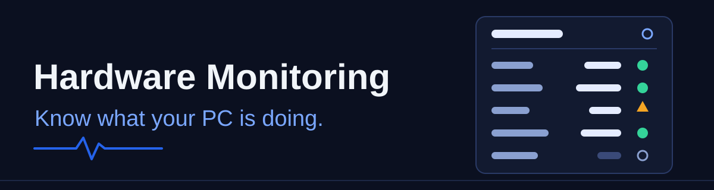
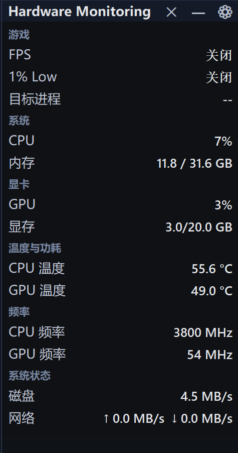
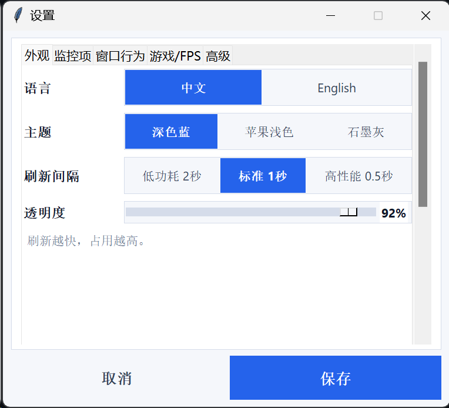
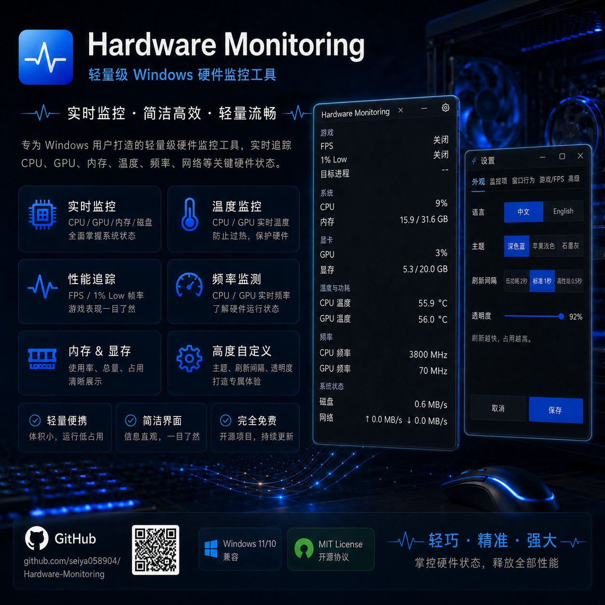

<p align="center">
  
</p>

A lightweight Windows overlay for live CPU, GPU, memory, temperature, and game-FPS readings. It tells you when a sensor value is fresh, degraded, stale, or unavailable instead of letting an old number pass for a live one.

**[Download for Windows](https://github.com/seiya058904/Hardware-Monitoring/releases/latest)** · [Get started](#get-started) · [Features](#features) · [LAN dashboard](#lan-dashboard) · [Development](#development)

[](https://github.com/seiya058904/Hardware-Monitoring/actions/workflows/ci.yml)

Latest release: [v1.0.16](https://github.com/seiya058904/Hardware-Monitoring/releases/tag/v1.0.16), for Windows x64. The interface is available in English and Simplified Chinese.

*Illustration of the overlay, not a screenshot. Real screenshots are below.*

<table>
  <tr>
    <td width="40%" valign="top"></td>
    <td width="60%" valign="top"></td>
  </tr>
</table>

*The overlay and its Settings window with the Chinese interface selected. The build they were captured from is not recorded, and the readings come from the author's PC.*

## Features

- **Live hardware readings.** CPU and GPU load, temperatures, clocks, power, fans, and VRAM, plus RAM usage, disk activity, network throughput, and battery status, wherever your hardware and drivers expose them.
- **Game performance.** Turn on FPS capture when you need it, choose the target game process, and read FPS and 1% Low where capture succeeds. Capture uses PresentMon.
- **A compact desktop overlay.** Choose which metrics appear and in what order, and adjust compact mode, opacity, theme, and refresh interval (0.5, 1, or 2 seconds). The overlay has a tray icon and window-position controls.
- **Honest sampling state.** Every sample is `ok`, `degraded`, `stale`, or `unavailable` (see [Sampling States](#sampling-states)).
- **An optional read-only LAN dashboard.** View the same readings from a phone, tablet, or another computer on your private network. It is off by default.

> [!NOTE]
> Available metrics depend on your hardware, drivers, permissions, and capture tools. Missing data is shown as unavailable, and not every PC can expose every sensor or provide frame-time statistics. NVIDIA-specific fallback sampling uses `nvidia-smi` when it is available.

## Get Started

**System and hardware:** the installer is for Windows x64. The project has been exercised on Windows 11 with an AMD Radeon RX 7900 XT. A minimum Windows version and broad GPU compatibility have not been established, and the installer's runtime prerequisites have not been comprehensively verified.

1. **Install.** Download [`HardwareMonitoring_Setup_v1.0.16.exe`](https://github.com/seiya058904/Hardware-Monitoring/releases/download/v1.0.16/HardwareMonitoring_Setup_v1.0.16.exe) from the [release page](https://github.com/seiya058904/Hardware-Monitoring/releases/tag/v1.0.16). The installer may ask for administrator approval.
2. **Set up the overlay.** Launch Hardware Monitoring and open Settings. Pick your metrics and their order, adjust compact mode, opacity, theme, and refresh interval, and enable game FPS collection or the LAN dashboard only if you need them. **Save** applies the settings; **Cancel** discards an unfinished preview.
3. **Keep it in reach.** Use the overlay beside your work or games, with tray access and window-position controls.

> [!IMPORTANT]
> The v1.0.16 installer and application are not code-signed, so Windows may show an Unknown Publisher or SmartScreen warning. Download only from the official Releases page and compare the installer's SHA-256 with the one published for the same release (`HardwareMonitoring_Setup_v1.0.16.sha256`) before running it:
>
> ```powershell
> Get-FileHash -Algorithm SHA256 -LiteralPath 'C:\path\to\HardwareMonitoring_Setup_v1.0.16.exe'
> ```

Configuration and logs are stored in `%LOCALAPPDATA%\Hardware Monitoring`. An ordinary uninstall is designed to keep that data.

## LAN Dashboard

While Hardware Monitoring runs on Windows, a phone, tablet, or other computer can open a read-only dashboard of the same data. It has English and Simplified Chinese text and light and dark themes.

1. Open the Windows app's Advanced settings and explicitly enable the LAN dashboard. It is off by default.
2. Put the viewing device and your PC on the same trusted private network.
3. Open the LAN address shown by the app in the other device's browser. The default port is `8765`.

The server answers only `GET /`, `GET /api/metrics`, and `GET /healthz`. It offers no remote control and no file access.

> [!WARNING]
> Use private networks only. The LAN server has no authentication, so never expose it to the public internet, a port forward, or a public tunnel. The app does not change your firewall or router settings.

The optional [Termux monitoring node](android/termux/README.md) can run outbound-only health checks from an Android phone against your Windows dashboard and other configured network targets. It opens no incoming port on the phone and is not needed for ordinary Windows monitoring.

## Sampling States

| State | Meaning |
| --- | --- |
| `ok` | Fresh readings are available. |
| `degraded` | Updated data is available, but one or more device sources had a problem. |
| `stale` | The last sample is too old to treat as current. |
| `unavailable` | A reliable sample is not currently available. |

On the LAN dashboard, sample state and age matter as much as whether the HTTP service responds. A healthy network response does not mean the hardware readings are fresh.

## Development

The overlay is Python and Tkinter. It reads sensors through LibreHardwareMonitor, captures game frames with PresentMon, and serves the optional LAN dashboard from a bounded, read-only HTTP server.

| Path | Purpose |
| --- | --- |
| [`app.py`](app.py) | Overlay, settings, tray, and dashboard integration |
| [`sensor_runtime.py`](sensor_runtime.py) | Sampling pipeline and freshness reporting |
| [`fps_stream.py`](fps_stream.py), [`fps_sessions.py`](fps_sessions.py) | Frame capture and active session ownership |
| [`service_runtime.py`](service_runtime.py) | Background service changes without blocking Tk |
| [`dashboard_server.py`](dashboard_server.py) | Bounded LAN request handling and shutdown |
| [`android/termux/`](android/termux/) | Optional outbound-only Android node |
| [`tests/`](tests/) | Core, desktop, sampling, and installer regressions |

On Windows, install the pinned dependencies and run from the repository root:

```powershell
python -m pip install -r requirements-runtime.txt
python app.py
python -m unittest discover -s tests -v
```

A fresh checkout also needs the exact pinned PresentMon and LibreHardwareMonitor binaries. [`scripts/fetch-dependencies.ps1`](scripts/fetch-dependencies.ps1) downloads them and verifies their SHA-256 hashes; do not substitute other binaries.

To build the installer, you need PyInstaller ([`requirements-build.txt`](requirements-build.txt)) and NSIS:

```powershell
python -m pip install -r requirements-build.txt
pyinstaller "Hardware Monitoring.spec" --noconfirm
makensis "Hardware Monitoring.nsi"
```

CI runs Python syntax checks and the core tests on Windows, plus the Termux contract tests on Linux. These do not prove physical Android behavior, multi-monitor scenarios, or successful ETW/FPS capture on every machine. See the [engineering upgrade](docs/engineering-upgrade-1.0.13.md), the [release audit](docs/release-audit-1.0.13.md), and the [repository guidelines](AGENTS.md).

## Concept Art

Concept art made for this project. It is an illustration, not a screenshot, and details may differ from the shipped interface. Wording in the artwork, including its license badge, is decorative: see the License and Notices section for the actual terms.



## License and Notices

Hardware Monitoring is an observation tool, not a substitute for professional hardware diagnostics. The repository does not declare a project-wide license, so public source access is not permission to redistribute or reuse the code. Third-party component licenses and provenance are in [`THIRD_PARTY_NOTICES.md`](THIRD_PARTY_NOTICES.md) and [`third_party/licenses/`](third_party/licenses/).
